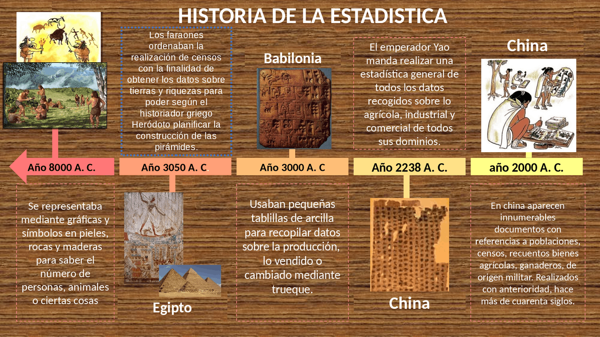
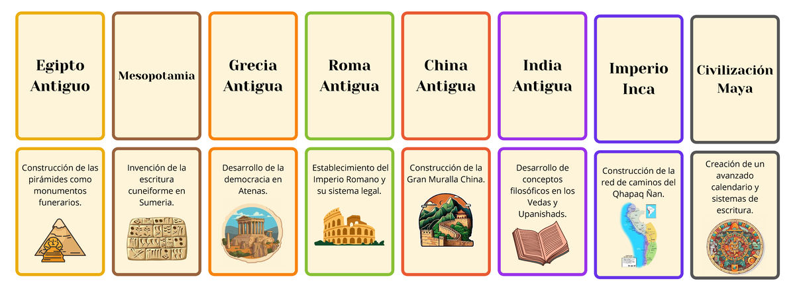
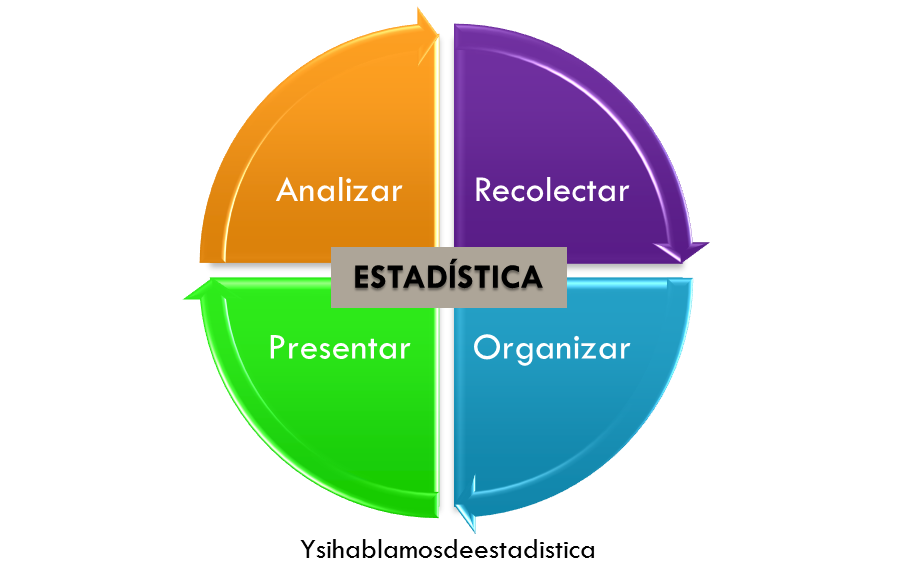
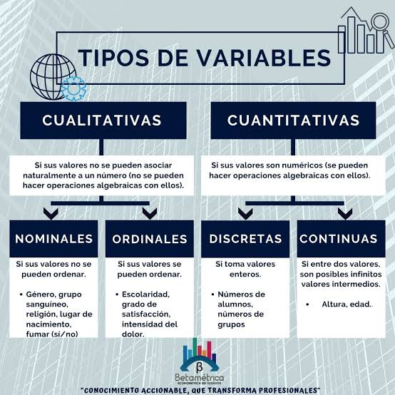
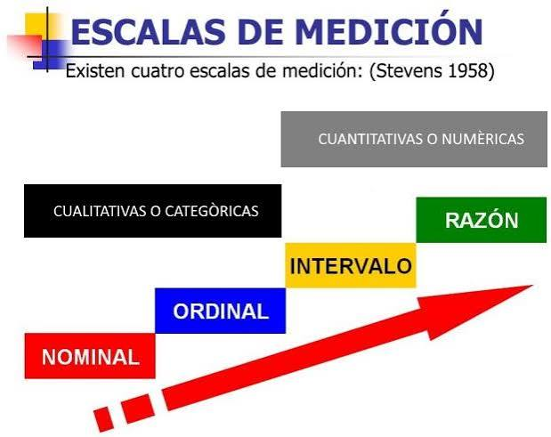
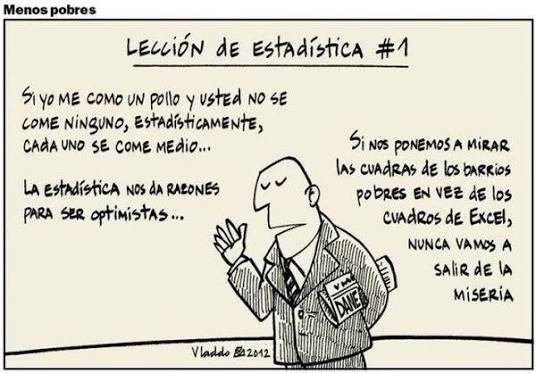

```{=html}
<div style="position:absolute; top:10px; right:10px;">

</div>
```

```{=html}
<style>
body{
  background-color:#DAF6E8;
  font-size:130%;
  text-align:justify;
}
</style>
```

# .Presentación

La estadística es una disciplina que permite convertir datos en información útil para describir fenómenos, reconocer patrones, contrastar afirmaciones y apoyar la toma de decisiones. Su aplicación abarca campos como la economía, la salud, la educación, las ciencias sociales, la ingeniería, la administración y las ciencias naturales.

Este documento desarrolla cuatro ejes: (1) una síntesis histórica de la estadística; (2) sus conceptos fundamentales; (3) la definición y clasificación de las variables según su naturaleza; y (4) los niveles o escalas de medición. Se incorporan ejemplos y fragmentos de código en **R** para ilustrar cómo organizar y examinar datos.

# .Historia de la estadística

**Orígenes y primeras necesidades de registro**



La estadística no apareció en un momento único ni fue creada de manera repentina. Surgió gradualmente, a partir de la necesidad de las comunidades y de los gobiernos de contar personas, animales, tierras, cosechas, bienes y recursos. Los registros permitían conocer la disponibilidad de recursos, organizar el trabajo, recaudar tributos y planificar actividades colectivas.

En épocas remotas se utilizaron marcas, símbolos y representaciones gráficas sobre pieles, rocas, madera y paredes de cuevas para llevar cuentas. El material histórico suministrado también menciona signos grabados en construcciones prehistóricas de Cerdeña, interpretados como posibles registros de ganado y piezas de caza.

**Aportes de las civilizaciones antiguas**



| *Civilización o período* | *Aporte* |
|------------------------------------|------------------------------------|
| Babilonia, hacia 3000 a. C. | Uso de tablillas de arcilla para registrar en tablas la producción agrícola y los bienes vendidos o intercambiados. |
| Egipto antiguo | Recolección de información sobre población y renta; realización periódica de censos y registros de movimientos poblacionales. |
| Asiria | Conservación de registros históricos, religiosos, productivos, contables, médicos y astronómicos en bibliotecas. |
| China antigua | Realización de censos y recopilación de información agrícola, industrial y comercial. |
| Grecia | Registros relacionados con la distribución de tierras, los tributos, el servicio militar y los recursos disponibles. |
| Roma | Recopilación sistemática de datos sobre población, territorio, rentas, nacimientos, defunciones, matrimonios y riquezas. |

Estos antecedentes muestran que, durante siglos, la actividad estadística estuvo estrechamente relacionada con la administración pública y la organización económica y militar.

**La estadística en la Edad Media y en América**

Durante la Edad Media europea disminuyó la actividad estadística sistemática en comparación con la tradición romana. El documento histórico destaca, entre otros registros, los inventarios de tierras vinculados a la Iglesia y los esfuerzos de Carlomagno y Guillermo el Conquistador por recuperar prácticas de registro.

En América, el material resalta el sistema de los **Incas**. Mediante los **quipus**, conjuntos de cuerdas y nudos, registraban información sobre población y acontecimientos relevantes. Se mencionan datos como nacimientos, defunciones, edad y sexo de los habitantes de distintas provincias. Este ejemplo evidencia que las prácticas de registro y cuantificación también tuvieron desarrollos propios en las sociedades americanas.

**Registros demográficos y desarrollo del análisis**

A partir de los siglos XVI y XVII adquirieron importancia los registros de nacimientos y defunciones. El material señala que en Inglaterra se desarrollaron registros de mortalidad y que, en 1662, *John Graunt* publicó un análisis de las partidas de defunción de Londres. Su trabajo es presentado como un antecedente importante del análisis estadístico de la población.

También se describe el aporte de *Gaspar Neumann*, quien examinó registros parroquiales para contrastar una creencia popular sobre la mortalidad en años terminados en siete. Sus resultados fueron utilizados posteriormente por *Edmond Halley* en el desarrollo de tablas de mortalidad, relevantes para el estudio de la duración de la vida y los seguros.

**Probabilidad, método científico y ciencias sociales**

Durante los siglos XVII y XVIII, matemáticos como *Bernoulli, Maseres, Lagrange y Laplace* contribuyeron al desarrollo de la teoría de la probabilidad. Inicialmente, algunos de sus usos se relacionaban con los juegos de azar; posteriormente, sus herramientas se extendieron a problemas científicos y a la evaluación de la incertidumbre.

El material también destaca:

- **Sebastián Münster:** recopilación de información sobre recursos nacionales, organización política, comercio y poder militar.
- **John Graunt:** análisis de registros de mortalidad y elaboración de estimaciones demográficas.
- **Edmond Halley:** aplicación de procedimientos cuantitativos al estudio de la mortalidad.
- **Jacques Quételet:** impulso de la aplicación de métodos estadísticos a las ciencias sociales.
- **Laplace, Gauss y Legendre:** contribuciones a la teoría de los errores de observación y al método de mínimos cuadrados, durante el desarrollo matemático de la estadística.

**La estadística contemporánea y la informática**

{fig-align="center"}

En la actualidad, la estadística se utiliza para describir, relacionar y analizar datos económicos, políticos, sociales, psicológicos, biológicos y físicos. El trabajo estadístico ya no se limita a reunir y tabular información: incluye interpretar resultados, evaluar la incertidumbre y comunicar conclusiones útiles.

El desarrollo de los computadores transformó la disciplina al facilitar el procesamiento de grandes volúmenes de datos, la aplicación de métodos matemáticos y la producción de representaciones gráficas. Herramientas como **R** permiten realizar análisis reproducibles mediante código.

**Síntesis de la evolución histórica**

De acuerdo con las etapas presentadas en el material histórico, la evolución puede resumirse así:

1.  **Etapa de los censos:** Recuento de habitantes, bienes, tierras y recursos.
2.  **Etapa descriptiva o de aritmética política:** Organización de registros y análisis de información relacionada con la población y el Estado.
3.  **Etapa de la estadística y el cálculo de probabilidades:** Desarrollo de fundamentos matemáticos para analizar datos y estudiar fenómenos inciertos.
4.  **Etapa computacional:** Uso de computadores y programas especializados para procesar, visualizar e interpretar conjuntos de datos cada vez mayores.

# .Conceptos

**¿Qué es la estadística?**

La estadística es la ciencia que recoge, organiza, presenta, analiza e interpreta datos con el propósito de obtener información y apoyar una toma de decisiones más eficaz.

Su proceso general puede representarse de la siguiente manera:

1.  Definir el problema y el objetivo del estudio.
2.  Identificar la población de interés.
3.  Seleccionar la muestra, cuando no sea viable estudiar toda la población.
4.  Determinar qué variables se medirán y cómo se recogerán los datos.
5.  Organizar y depurar la información.
6.  Analizar los datos mediante tablas, gráficos y medidas estadísticas.
7.  Interpretar los resultados y comunicar las conclusiones.

**Estadística descriptiva**

La **estadística descriptiva** comprende métodos para organizar, resumir y presentar datos de manera informativa. Permite describir lo que se observa en el conjunto de datos estudiado.

Entre sus herramientas se encuentran:

- Tablas de frecuencia.
- Gráficos de barras, sectores, histogramas y diagramas de caja.
- Medidas de tendencia central: media, mediana y moda.
- Medidas de dispersión: rango, varianza y desviación estándar.
- Medidas de posición, como cuartiles y percentiles.

**Ejemplo:** una universidad presenta una tabla y un gráfico con las calificaciones obtenidas por los estudiantes de un curso. El análisis describe los resultados del grupo observado, pero por sí solo no demuestra que todos los estudiantes de otras universidades tengan un comportamiento similar.

**Estadística inferencial**

La **estadística inferencial** utiliza información de una muestra para estimar, contrastar hipótesis o formular conclusiones acerca de una población. Sus conclusiones incorporan incertidumbre, porque se basan en una parte de la población y no necesariamente en todos sus integrantes.

Algunas herramientas de la inferencia son:

- Estimación de parámetros.
- Intervalos de confianza.
- Pruebas de hipótesis.
- Modelos de regresión.
- Métodos de predicción.

**Ejemplo:** se encuesta a una muestra de votantes para estimar la proporción de apoyo a una propuesta en toda la población electoral. La estimación debe interpretarse considerando el diseño de muestreo y el margen de incertidumbre.

**Diferencia entre estadística descriptiva e inferencial**

| Aspecto | Descriptiva | Inferencial |
|------------------------|------------------------|------------------------|
| Propósito | Describir y resumir los datos observados. | Estimar o contrastar afirmaciones sobre una población. |
| Base de análisis | Datos disponibles del grupo estudiado. | Una muestra y un modelo o procedimiento inferencial. |
| Resultados | Tablas, gráficos y medidas descriptivas. | Estimaciones, intervalos, pruebas y predicciones. |
| Alcance | Se refiere principalmente a los datos analizados. | Busca generalizar, con incertidumbre explícita, a una población. |

La estadística descriptiva y la inferencial son complementarias. Una descripción adecuada ayuda a comprender los datos antes de realizar inferencias.

**Población**

La **población** es el conjunto completo de individuos, objetos, unidades o mediciones que cumplen las características de interés para una investigación.

Ejemplos:

- Todos los estudiantes matriculados en una universidad durante un período determinado.
- Todos los habitantes de un municipio.
- Todos los productos fabricados por una empresa durante un mes.
- Todos los pacientes atendidos en un hospital durante un año.

La población debe delimitarse con claridad, indicando quiénes o qué elementos la integran, dónde y en qué período.

**Muestra**

La **muestra** es una parte de la población seleccionada para obtener información y estudiar el fenómeno de interés. Para que los resultados puedan generalizarse, la selección debe responder a un diseño apropiado y reducir, en lo posible, los sesgos.

Se recurre al muestreo, entre otras razones, porque estudiar toda la población puede requerir demasiado tiempo y dinero, ser logísticamente difícil o implicar pruebas destructivas. El material introductorio ilustra estas limitaciones con el control de calidad de productos, los análisis de sangre y las pruebas de velocidad de vehículos.

**Ejemplo:** si una universidad tiene 8.000 estudiantes y se seleccionan 400 mediante un procedimiento de muestreo definido, los 8.000 estudiantes constituyen la población y los 400 seleccionados conforman la muestra.

**Unidad de análisis, dato y variable**

- **Unidad de análisis:** persona, objeto, institución, evento o elemento sobre el que se recoge información.
- **Dato:** valor observado o registrado para una unidad de análisis.
- **Variable:** característica que puede tomar distintos valores entre las unidades de análisis.

Ejemplo: en un estudio sobre estudiantes, cada estudiante es una unidad de análisis; la edad es una variable; y 21 años es un dato observado para uno de ellos.

**Parámetro y estadístico**

- **Parámetro:** medida numérica que describe una característica de una población, como la media poblacional.
- **Estadístico:** medida calculada a partir de una muestra, como la media muestral.

La inferencia estadística utiliza estadísticos muestrales para obtener información sobre parámetros poblacionales.

**Instrumentos y fuentes de recolección de datos**

El material introductorio enumera instrumentos y procedimientos como:

- Encuestas.
- Entrevistas.
- Cuestionarios.
- Observación.
- Registros de control de calidad.
- Reportes de producción.

La elección depende del objetivo, la población, la variable y las condiciones de recolección. Un instrumento debe recoger información pertinente y de manera consistente.

# .Variables estadísticas: concepto y clasificación según su naturaleza

{fig-align="center"}

**¿Qué es una variable?**

Una **variable estadística** es una característica de las unidades de análisis que puede adoptar diferentes valores o categorías. En un estudio, la información recolectada se almacena y organiza mediante variables para facilitar su clasificación, análisis y presentación.

Ejemplos de variables:

- Edad de los estudiantes.
- Estatura de una persona.
- Estado civil.
- Tipo de automóvil.
- Número de libros en una biblioteca.
- Temperatura de un paciente.

Es importante distinguir entre el nombre de la variable y el valor que toma. Por ejemplo, `estatura` es la variable y `1.68 metros` es uno de sus posibles valores.

**Clasificación según su naturaleza**

Según el material *Variables, niveles de medición*, las variables se clasifican en **cualitativas** y **cuantitativas**. Las cuantitativas se subdividen en **discretas** y **continuas**.

```{mermaid}
flowchart TD
    A["Variables estadísticas"] --> B["Cualitativas"]
    A --> C["Cuantitativas"]
    C --> D["Discretas"]
    C --> E["Continuas"]
```

**Variables cualitativas**

Las variables **cualitativas**, también denominadas variables de atributo, describen cualidades, categorías o características no expresadas como cantidades medibles.

Ejemplos:

- Estado civil: soltero, casado, viudo, separado.
- Tipo de automóvil: automóvil, camioneta, camión.
- Marca de computador: Dell, HP, Apple, Lenovo.
- Color de ojos: café, verde, azul.
- Tipo de vivienda: casa, apartamento, habitación.

Una variable puede estar codificada con números y seguir siendo cualitativa. Por ejemplo, si se registra `1 = soltero`, `2 = casado` y `3 = viudo`, los números son etiquetas de categorías: no representan cantidades ni permiten afirmar que 3 sea más que 1.

Las variables cualitativas pueden ser:

- **Nominales:** sus categorías no tienen un orden inherente. Ejemplo: tipo de automóvil o grupo sanguíneo.
- **Ordinales:** sus categorías tienen un orden significativo. Ejemplo: nivel de satisfacción (bajo, medio, alto).

**Variables cuantitativas**

Las variables **cuantitativas** expresan cantidades mediante números y representan conteos o mediciones. El material de apoyo señala ejemplos como edad, estatura, saldo, número de unidades producidas, litros vendidos y calificaciones.

Se clasifican en discretas y continuas.

*Variables cuantitativas discretas*

Son variables que resultan de contar elementos. Generalmente toman valores enteros dentro de un conjunto de valores posibles.

Ejemplos:

- Número de estudiantes de un salón.
- Cantidad de camas de un hospital.
- Número de libros de una biblioteca.
- Cantidad de vehículos que ingresan a una ciudad.
- Número de cajas producidas en un turno.

No tiene sentido registrar 2,5 estudiantes o 4,7 camas en un conteo de unidades individuales.

*Variables cuantitativas continuas*

Son variables que resultan de medir una magnitud y que, conceptualmente, pueden tomar cualquier valor dentro de un intervalo, según la precisión del instrumento.

Ejemplos:

- Estatura y peso.
- Temperatura corporal.
- Presión arterial.
- Volumen de agua.
- Longitud de un río.
- Tiempo empleado en completar una actividad.

Una medición puede registrarse con distintos niveles de precisión. Por ejemplo, una estatura puede anotarse como 1,7 m, 1,72 m o 1,723 m.

**Cuadro comparativo de la naturaleza de las variables**

| Tipo | Definición | Pregunta orientadora | Ejemplos |
|------------------|------------------|------------------|------------------|
| Cualitativa | Describe categorías o atributos. | ¿Qué tipo o categoría? | Estado civil, color, marca. |
| Cuantitativa discreta | Cuenta unidades separadas. | ¿Cuántos? | Número de hijos, libros o vehículos. |
| Cuantitativa continua | Mide una magnitud. | ¿Cuánto mide, pesa o dura? | Estatura, peso, temperatura y tiempo. |

**Criterio práctico:** si los valores representan nombres o categorías, la variable es cualitativa. Si representan cantidades, es cuantitativa. Si se cuentan unidades, suele ser discreta; si se mide una magnitud, suele ser continua.

# .Escalas o niveles de medición

{fig-align="center"}

**¿Qué es una escala de medición?**

La escala o nivel de medición indica qué propiedades tienen los valores de una variable y qué comparaciones u operaciones son válidas. Elegir correctamente el nivel de medición permite seleccionar resúmenes, gráficos y procedimientos estadísticos adecuados.

Los cuatro niveles clásicos son **nominal, ordinal, intervalo y razón**.

**Nivel nominal**

El nivel **nominal** clasifica las observaciones en categorías que no tienen un orden natural. Su propósito es identificar y contar categorías.

Ejemplos:

- Tipo de sangre.
- Estado civil.
- Marca de vehículo.
- Municipio de residencia.
- Tipo de vivienda.

Los códigos numéricos que se asignen a las categorías no cambian su naturaleza. Si se codifica `1 = casa`, `2 = apartamento` y `3 = habitación`, no significa que una categoría sea mayor que otra.

**Análisis habitual:** frecuencias absolutas y relativas, porcentajes, moda y gráficos de barras o sectores.

**Nivel ordinal**

El nivel **ordinal** agrupa categorías que pueden ordenarse, pero las distancias entre categorías no necesariamente son iguales o conocidas.

Ejemplos:

- Nivel educativo: primaria, secundaria, superior.
- Satisfacción: baja, media, alta.
- Nivel de riesgo: bajo, moderado, alto.
- Posición en una competencia: primero, segundo, tercero.

El orden aporta información, pero no permite asumir que la diferencia entre bajo y medio sea igual a la diferencia entre medio y alto.

**Análisis habitual:** frecuencias, porcentajes, moda, mediana, percentiles y métodos no paramétricos apropiados.

**Nivel de intervalo**

El nivel **de intervalo** presenta valores ordenados en los que las diferencias iguales representan diferencias iguales en la característica medida. Sin embargo, el cero es convencional o arbitrario y no indica ausencia absoluta de la característica.

Ejemplo: temperatura en grados Celsius. La diferencia entre 10 °C y 20 °C es igual a la diferencia entre 20 °C y 30 °C, pero 0 °C no significa ausencia de temperatura. Por ello, no es correcto afirmar que 20 °C representa el doble de temperatura que 10 °C.

Otros ejemplos que suelen tratarse como escalas de intervalo son ciertas puntuaciones estandarizadas, bajo los supuestos propios de su construcción.

**Análisis habitual:** media, desviación estándar, diferencias y correlaciones, siempre que el diseño y los supuestos del análisis lo permitan. Las razones entre valores no tienen interpretación directa.

**Nivel de razón**

El nivel **de razón** posee las propiedades de orden y de intervalos iguales, además de un cero absoluto que representa ausencia de la cantidad medida. Por ello, las diferencias y las razones tienen interpretación.

Ejemplos:

- Peso.
- Estatura o longitud.
- Distancia recorrida.
- Duración o tiempo transcurrido.
- Edad medida como tiempo desde el nacimiento.
- Número de unidades producidas.
- Ingresos, cuando se miden en una escala monetaria con cero significativo.

Por ejemplo, 10 kg representan el doble de masa que 5 kg. En cambio, esa interpretación de doble no es válida para grados Celsius.

**Análisis habitual:** admite operaciones aritméticas y una amplia variedad de resúmenes y modelos, según el contexto.

**Comparación de las cuatro escalas**

| Nivel | Clasifica | Ordena | Diferencias iguales | Cero absoluto | Ejemplo |
|------------|-----------:|-----------:|-----------:|-----------:|------------|
| Nominal | Sí | No | No | No aplica | Grupo sanguíneo |
| Ordinal | Sí | Sí | No necesariamente | No aplica | Satisfacción baja, media, alta |
| Intervalo | Sí | Sí | Sí | No | Temperatura en °C |
| Razón | Sí | Sí | Sí | Sí | Peso en kg |

**Relación entre naturaleza y escala de medición**

La naturaleza de una variable y su escala de medición son dos criterios relacionados, pero no equivalentes:

- Las variables cualitativas suelen medirse en escala nominal u ordinal.
- Las variables cuantitativas pueden medirse en escala de intervalo o de razón.
- Una variable codificada con números no necesariamente es cuantitativa.
- La clasificación depende del significado de los valores y de la forma en que se obtuvo la información.

| Variable | Naturaleza | Escala de medición | Justificación |
|------------------|------------------|------------------|------------------|
| Tipo de sangre | Cualitativa | Nominal | Categorías sin orden. |
| Nivel de satisfacción | Cualitativa | Ordinal | Categorías ordenables. |
| Temperatura en °C | Cuantitativa continua | Intervalo | Diferencias interpretables; cero no absoluto. |
| Peso en kg | Cuantitativa continua | Razón | Cero absoluto y razones interpretables. |
| Número de hijos | Cuantitativa discreta | Razón | Conteo con cero significativo. |
| Posición en una carrera | Cualitativa ordinal | Ordinal | Expresa orden, no distancia entre posiciones. |

# .Aplicación práctica con R

{fig-align="center"}

R es un lenguaje y entorno de programación para el análisis estadístico y la visualización de datos. En esta sección se construye una base de datos pequeña, se identifican variables y se realizan operaciones descriptivas básicas.

**Crear una base de datos de ejemplo**

El siguiente conjunto de datos es **simulado** y tiene fines didácticos. Cada fila representa un estudiante.

```{r}
estudiantes <- data.frame(
  id = 1:10,
  programa = c("Administración", "Matemáticas", "Administración",
               "Derecho", "Matemáticas", "Derecho",
               "Administración", "Derecho", "Matemáticas",
               "Administración"),
  nivel_satisfaccion = c("Alto", "Medio", "Alto", "Bajo", "Medio",
                         "Alto", "Bajo", "Medio", "Alto", "Medio"),
  edad = c(19, 22, 21, 25, 20, 23, 24, 19, 22, 26),
  numero_hijos = c(0, 1, 0, 2, 0, 1, 1, 0, 0, 2),
  estatura_m = c(1.62, 1.75, 1.68, 1.71, 1.59,
                 1.80, 1.66, 1.73, 1.64, 1.77),
  temperatura_c = c(36.5, 36.7, 36.6, 37.0, 36.4,
                     36.8, 36.6, 36.5, 36.9, 36.7)
)

estudiantes
```

**Identificar la naturaleza y la escala de las variables**

| Variable | Naturaleza | Escala | Comentario |
|------------------|------------------|------------------|------------------|
| `id` | Cualitativa identificadora | Nominal | El número identifica al estudiante; no mide una cantidad. |
| `programa` | Cualitativa | Nominal | Sus categorías no tienen orden. |
| `nivel_satisfaccion` | Cualitativa | Ordinal | Bajo, medio y alto tienen orden. |
| `edad` | Cuantitativa | Razón | El cero representa ausencia de tiempo vivido; aquí se registra en años cumplidos. |
| `numero_hijos` | Cuantitativa discreta | Razón | Es un conteo con cero significativo. |
| `estatura_m` | Cuantitativa continua | Razón | Es una medición con cero absoluto conceptual. |
| `temperatura_c` | Cuantitativa continua | Intervalo | El cero Celsius no representa ausencia de temperatura. |

El identificador `id` merece atención: aunque está escrito con números, funciona como una etiqueta. No debe calcularse su promedio para describir a los estudiantes.

**Convertir variables a factores en R**

En R, las variables categóricas pueden representarse mediante el tipo `factor`. Para las categorías ordenadas se puede especificar el orden de sus niveles.

```{r}
estudiantes$programa <- factor(estudiantes$programa)

estudiantes$nivel_satisfaccion <- factor(
  estudiantes$nivel_satisfaccion,
  levels = c("Bajo", "Medio", "Alto"),
  ordered = TRUE
)

str(estudiantes)
```

La función `str()` permite revisar la estructura de la base de datos y el tipo de cada columna.

**Frecuencias para variables cualitativas**

```{r}
# Frecuencia absoluta por programa
table(estudiantes$programa)

# Frecuencia relativa por programa
prop.table(table(estudiantes$programa))

# Frecuencia de los niveles de satisfacción
table(estudiantes$nivel_satisfaccion)
```

Para expresar las frecuencias relativas como porcentajes:

```{r}
round(100 * prop.table(table(estudiantes$programa)), 1)
```

**Resumen de variables cuantitativas**

```{r}
# Resumen general de la base
summary(estudiantes)

# Media de edad
mean(estudiantes$edad)

# Mediana de estatura
median(estudiantes$estatura_m)

# Desviación estándar de la edad
sd(estudiantes$edad)

# Mínimo y máximo de temperatura
range(estudiantes$temperatura_c)
```

Estas medidas describen únicamente los diez registros simulados. No deben interpretarse como estimaciones de una población real.

**Representaciones gráficas**

*Gráfico de barras: programa académico*

```{r}
barplot(
  table(estudiantes$programa),
  main = "Estudiantes por programa académico",
  xlab = "Programa",
  ylab = "Número de estudiantes"
)
```

*Histograma: edad*

```{r}
hist(
  estudiantes$edad,
  main = "Distribución de las edades",
  xlab = "Edad (años)",
  ylab = "Frecuencia"
)
```

*Diagrama de caja: estatura*

```{r}
boxplot(
  estudiantes$estatura_m,
  main = "Distribución de la estatura",
  ylab = "Estatura (metros)"
)
```

La selección del gráfico depende del tipo de variable: las barras son útiles para categorías; los histogramas y diagramas de caja se utilizan habitualmente para variables cuantitativas.

# .Ejercicios de aplicación

{fig-align="center" width="442"}

**Ejercicio 1. Clasificación según la naturaleza**

Clasifique cada variable como cualitativa, cuantitativa discreta o cuantitativa continua.

1.  Marca de los vehículos que ingresan a un parqueadero.
2.  Número de estudiantes matriculados en una institución.
3.  Temperatura de los pacientes de un hospital.
4.  Estado civil de los habitantes de un municipio.
5.  Litros de agua consumidos por una familia.
6.  Cantidad de libros de una biblioteca.
7.  Estatura de los estudiantes de un curso.
8.  Nivel de satisfacción con un servicio.

**Ejercicio 2. Identificación de la escala de medición**

Determine si cada variable corresponde a una escala nominal, ordinal, de intervalo o de razón.

1.  Grupo sanguíneo.
2.  Nivel educativo alcanzado.
3.  Temperatura en grados Celsius.
4.  Distancia recorrida en kilómetros.
5.  Número de llamadas recibidas en un día.
6.  Posición obtenida en una competencia.
7.  Tiempo de duración de una llamada.
8.  Tipo de vivienda.

**Ejercicio 3. Población y muestra**

Una institución universitaria cuenta con 5.000 estudiantes y desea conocer el tiempo semanal que dedican al estudio. Para ello, selecciona 250 estudiantes mediante un procedimiento de muestreo.

Responda:

1.  ¿Cuál es la población?
2.  ¿Cuál es la muestra?
3.  ¿Cuál es la unidad de análisis?
4.  ¿Cuál es la variable principal?
5.  ¿La variable tiempo semanal de estudio es cualitativa o cuantitativa?
6.  ¿Qué escala de medición corresponde al tiempo de estudio?

**Ejercicio 4. Descriptiva o inferencial**

Indique si cada situación corresponde principalmente a estadística descriptiva o inferencial.

1.  Calcular el promedio de calificaciones de todos los estudiantes de un curso.
2.  Encuestar una muestra de hogares para estimar el gasto promedio de todos los hogares de una ciudad.
3.  Elaborar un gráfico con las ventas mensuales registradas por una tienda.
4.  Utilizar una muestra de pacientes para estimar la proporción de personas con una condición en una población.

# .Respuestas orientadoras

**Ejercicio 1**

1.  Cualitativa.
2.  Cuantitativa discreta.
3.  Cuantitativa continua.
4.  Cualitativa.
5.  Cuantitativa continua.
6.  Cuantitativa discreta.
7.  Cuantitativa continua.
8.  Cualitativa ordinal.

**Ejercicio 2**

1.  Nominal.
2.  Ordinal.
3.  Intervalo.
4.  Razón.
5.  Razón.
6.  Ordinal.
7.  Razón.
8.  Nominal.

**Ejercicio 3**

1.  Población: los 5.000 estudiantes de la institución.
2.  Muestra: los 250 estudiantes seleccionados.
3.  Unidad de análisis: cada estudiante.
4.  Variable principal: tiempo semanal dedicado al estudio.
5.  Cuantitativa continua, si se registra como una duración medible.
6.  Razón, porque el tiempo transcurrido tiene cero absoluto y permite comparar proporciones.

**Ejercicio 4**

1.  Descriptiva, porque resume las calificaciones del curso observado.
2.  Inferencial, porque utiliza una muestra para estimar una característica de todos los hogares.
3.  Descriptiva, porque presenta los registros de ventas observados.
4.  Inferencial, porque estima una proporción poblacional a partir de una muestra.

# .Conclusiones

{fig-align="center"}

La estadística evolucionó desde prácticas elementales de conteo y registro hasta convertirse en una disciplina científica apoyada en la probabilidad, los métodos matemáticos y las herramientas computacionales. Su finalidad no consiste únicamente en acumular datos, sino en transformarlos en información que permita comprender fenómenos y tomar decisiones fundamentadas.

Los conceptos de población, muestra, unidad de análisis, dato y variable constituyen la base de cualquier estudio estadístico. Distinguir entre estadística descriptiva e inferencial permite reconocer el alcance de los resultados y evitar generalizaciones que los datos no respaldan.

La clasificación de las variables según su naturaleza —cualitativas y cuantitativas, estas últimas discretas o continuas— y según su escala de medición —nominal, ordinal, intervalo y razón— es esencial para elegir procedimientos de análisis adecuados. Una codificación numérica no convierte automáticamente una categoría en una cantidad medible: siempre debe considerarse el significado de los datos.

Finalmente, R facilita la organización, descripción y visualización de datos mediante procedimientos reproducibles. El criterio estadístico, sin embargo, sigue siendo indispensable para definir las variables, seleccionar las técnicas y formular interpretaciones válidas.

# .Referencias y materiales de consulta

- Salgado Horta, D. (s. f.). *Historia de la Estadística* \[Material de apoyo de clase, 40 páginas\].
- Salgado Horta, D. (2026). *Estadística: Introducción - tipos de datos. Período 2026-1* \[Presentación de clase, 14 páginas\].
- Salgado Horta, D. (2026). *Estadística: Variables, niveles de medición. Período 2026-1* \[Presentación de clase, 20 páginas\].

# .Anexo. Comandos básicos de R utilizados

| Función        | Utilidad                                  |
|----------------|-------------------------------------------|
| `data.frame()` | Crear una base de datos tabular.          |
| `str()`        | Examinar la estructura de un objeto.      |
| `summary()`    | Obtener un resumen de variables.          |
| `table()`      | Calcular frecuencias.                     |
| `prop.table()` | Calcular proporciones de una tabla.       |
| `mean()`       | Calcular la media.                        |
| `median()`     | Calcular la mediana.                      |
| `sd()`         | Calcular la desviación estándar muestral. |
| `range()`      | Obtener mínimo y máximo.                  |
| `barplot()`    | Crear un gráfico de barras.               |
| `hist()`       | Crear un histograma.                      |
| `boxplot()`    | Crear un diagrama de caja.                |
| `factor()`     | Definir variables categóricas.            |


